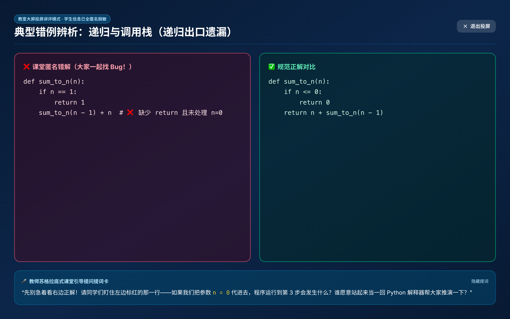
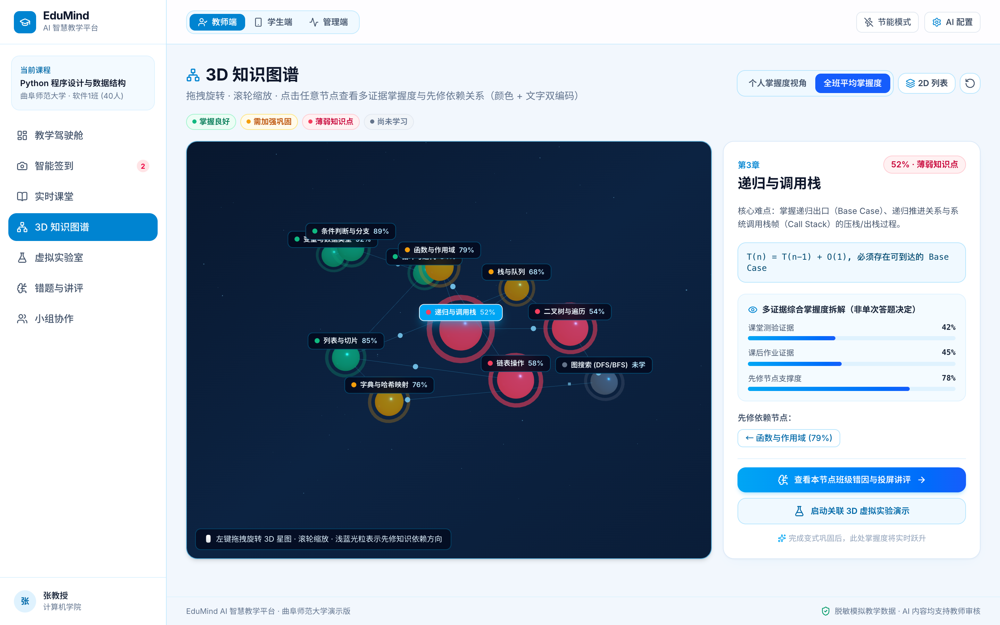

# EduMind｜AI 原生智慧教学平台 · 项目说明文档与路演材料

> **参赛赛道**：赛道二 · 学习教育（乐学智教） — 赛题二：辅助教师教学的工具  
> **在线演示链接（评委打开即用）**：https://sjz-wgh.cn/  
> **代码仓库分支**：https://github.com/kong2758045884/heikesong/tree/dev-wgh  
> **核心开发工具**：**TRAE**（主力 AI IDE，承担需求拆解、全栈组件生成、交互调试与 Unslop 视觉精修）  
> **适用院校场景**：曲阜师范大学 · 本科计算机类课程（以《Python 程序设计与数据结构》为例，可无缝迁移全学科）

---

## 一、500 字以内作品说明（可直接用于报名表提交）

**EduMind** 是一款面向高校师生的 AI 原生智慧教学平台，聚焦“**让老师更容易教，让学生真正学会**”，围绕课前、课中、课后构建完整教学闭环，产出可直接用于真实课堂与课后讲评。

针对传统教学平台“考勤易代签、课堂参与难量化、作业批改讲评耗时、学生薄弱点不清晰”四大痛点，EduMind 创新采用**教师桌面驾驶舱 + 学生移动端（底部 5 栏）**双端形态：课前通过浏览器端 **MediaPipe 21 关键点模型**实现“指定手势 + 实景拍照 + 教师人工复核”真实签到；课中提供绑定课件页码的 **AI 课堂副驾驶**、中英双语术语字幕、AI 实时出题与自动课堂笔记；课后通过**四维错因诊断**联动 **Three.js 3D 知识图谱**与 **3D 虚拟实验室**，并支持教师一键开启**脱敏错例大屏投屏讲评**、风格化评语模板与 A/B/C 分层巩固作业导出。

作品以 **TRAE** 为主力 AI 研发工具完成前端工程构建、交互调试与上线部署，所有演示均采用自建脱敏模拟课程数据，支持教师审核与低性能降级，现已部署上线（https://sjz-wgh.cn/），开箱即可体验全流程闭环。

---

## 二、目标用户与真实痛点

| 目标用户 | 核心使用端 | 日常高频痛点 | EduMind 提供的直接价值 |
| :--- | :--- | :--- | :--- |
| **高校授课教师 / 师范生** | **桌面端数据驾驶舱** | 改完作业还要统计全班错因、写差异化评语、做明天讲评 PPT，重复劳动极重；传统二维码签到容易代签。 | AI 四维错因聚类 + 一键**教室脱敏投屏讲评** + 风格评语模板 + A/B/C 分层作业导出，1 分钟备好讲评课。 |
| **在校大学生** | **移动端 App（底部 5 栏）** | 课上听不懂不好意思举手；抽象概念（如递归调用栈）看不懂；课后错题只知对错不知原因。 | 匿名问课件上下文 AI 副驾驶 + 3D 虚拟实验室亲手演练 + 错题变式验证后**实时点亮 3D 知识图谱**。 |
| **教务与平台管理员** | **运维与合规中心** | AI 服务调用不可控、签到影像存在隐私合规风险、班级权限隔离困难。 | RBAC 角色隔离、AI 调用监控、签到影像 24 小时自动销毁策略与替代签到通道。 |

---

## 三、方案内容与核心界面展示

### 3.1 教师端数据驾驶舱与智能签到

### 3.2 AI 实时智慧课堂与脱敏投屏讲评

### 3.3 3D 互动知识图谱与 3D 虚拟实验室

### 3.4 学生端专属移动端体验（底部 5 栏）

---

## 四、设计思路、技术实现与 TRAE 使用声明

- **双端差异化设计**：教师端采用桌面宽屏数据驾驶舱，学生端采用底部 5 栏（首页/签到/课堂/图谱/错题）极简单列移动端布局；整体遵循克制浅蓝色 Unslop 美学，兼顾教室投影与手机阅读体验。
- **技术架构**：基于 `Vite + React 19 + TypeScript + Tailwind CSS v4 + Three.js + Recharts + MediaPipe` 构建，本地托管 MediaPipe WASM 与 `hand_landmarker.task` 模型，实现真机 21 关键点实时手势防作弊识别；支持内置课程上下文 AI 引擎开箱即用与外部大模型 API 热插拔。
- **TRAE 使用情况如实声明**：本项目全流程以 **TRAE** 为主力 AI IDE 完成需求拆解、组件编码、MediaPipe 几何判定算法调试、浅蓝 Unslop 视觉精修与线上部署；教学课件与学情数据均为自建脱敏模拟数据，不含真实学生隐私或涉密信息，所有 AI 建议均支持教师审核与编辑。
